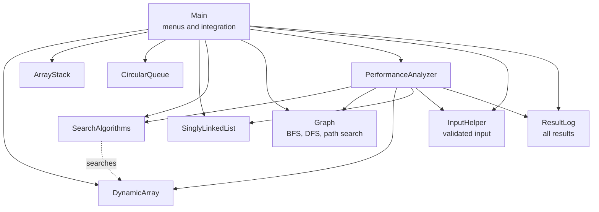

<div align="center">

# Data Structure & Graph Performance Analyzer

**A Java console application that implements core data structures and algorithms, and measures their performance.**


CIT300 Data Structures and Algorithms &nbsp;|&nbsp; Graded Practical Assignment 2 &nbsp;|&nbsp; Sri Lanka Technology Campus (SLTC)

</div>

---

## Table of Contents

1. [Overview](#1-overview)
2. [Features](#2-features)
3. [Demo](#3-demo)
4. [Architecture](#4-architecture)
5. [Complexity Summary](#5-complexity-summary)
6. [Project Structure](#6-project-structure)
7. [Getting Started](#7-getting-started)
8. [Usage Guide](#8-usage-guide)
9. [Design Decisions](#9-design-decisions)
10. [Testing](#10-testing)
11. [Team and Contributions](#11-team-and-contributions)
12. [Collaboration Workflow](#12-collaboration-workflow)
13. [Limitations and Future Improvements](#13-limitations-and-future-improvements)

---

## 1. Overview

This project is a single integrated, menu-driven Java console application. It lets a user work with the main
data structures from the course (**Array, Stack, Queue, Linked List, Graph**) and the main algorithms
(**Linear Search, Binary Search, BFS, DFS**).

Its second purpose is **measurement**. Every search, traversal and performance run records the **number of
steps** and the **execution time**, so the results can be explained with algorithmic complexity (Big-O).
For example, finding the last of 100,000 items takes 100,000 steps with Linear Search, but only 17 steps with
Binary Search.

**Group Number:** 56

**Repository:** [https://github.com/The-Prabhath/CIT300-Data-Structure-Graph-Analyzer](https://github.com/The-Prabhath/CIT300-Data-Structure-Graph-Analyzer)

### Learning outcomes demonstrated

- Correct implementation of the Array, Stack, Queue and Linked List from scratch. The Graph uses Java
  collections (`Map`, `List`, `Deque`) for its adjacency list and traversal helpers.
- Appropriate use of algorithms for searching and graph traversal
- Graph representation and operations
- Performance and operation comparison using steps and time
- Input validation and safe handling of empty structures
- Object-oriented design with one class per component
- Collaborative development using GitHub

---

## 2. Features

| Component | What you can do |
|---|---|
| **Array** | Insert at index, append, delete at index, display, sort, fill with random numbers. Resizes automatically. |
| **Stack** | Push, pop, peek, display. Safe handling of stack underflow. |
| **Queue** | Enqueue, dequeue, peek (front), display. Circular array. Safe handling of queue underflow. |
| **Linked List** | Insert at head, tail or position; delete by value; search; reverse; display. |
| **Searching** | Linear search, binary search (sorted-array check with a sort prompt), and a side-by-side comparison. |
| **Graph** | Add vertex, add edge, display adjacency list, BFS, DFS, shortest-path search, load a sample graph. |
| **Performance Comparison** | One table comparing search algorithms, graph traversals and array-vs-list insertion, followed by an explanation. |
| **Display All Results** | Lists every search, traversal and performance result recorded in the session. |

### Robust input handling

- Letters, symbols and out-of-range numbers are rejected and the prompt repeats.
- Pop, peek, dequeue and delete on an empty structure show a clear message and never crash.
- Invalid array indexes and list positions are rejected.
- Graph rejects duplicate vertices, duplicate edges, self-loops and unknown vertices.

---

## 3. Demo

### Main menu

```
=============================================
 DATA STRUCTURE & GRAPH ANALYZER
=============================================
1. Array Operations
2. Stack Operations
3. Queue Operations
4. Linked List Operations
5. Searching Operations
6. Graph Operations
7. Performance Comparison
8. Display All Results
9. Exit
Enter your choice:
```

### Graph operations on the built-in sample graph

```
Adjacency List (7 vertices, 7 edges):
  A -> B, C
  B -> A, D, E
  C -> A, F
  D -> B
  E -> B, F
  F -> C, E, G
  G -> F

BFS from A: A -> B -> C -> D -> E -> F -> G | steps: 21
DFS from A: A -> B -> D -> E -> F -> C -> G | steps: 21
Shortest path (3 edges): A -> C -> F -> G
```

### Performance comparison (n = 100,000)

```
=============================================
 PERFORMANCE COMPARISON  (n = 100000)
=============================================
Operation          Algorithm                       Steps      Time (us)
-------------------------------------------------------------------------
Search (worst)     Linear Search                  100000        5841.03
Search (worst)     Binary Search                      17           4.66
Search (avg x100)  Linear Search                   49501         175.95
Search (avg x100)  Binary Search                      15           1.51
Traversal V=5000   BFS                             25000       18681.02
Traversal V=5000   DFS                             25000       19575.91
Insert front x20000 Array (shifting)            200010000       86052.85
Insert front x20000 Linked List (head)              20000        2626.81
-------------------------------------------------------------------------
```

> Step counts are deterministic. Times vary between machines and runs, so **steps are the reliable
> measure** when comparing algorithms.

### Why the results differ

| Comparison | Explanation |
|---|---|
| Linear vs Binary Search | Linear checks items one by one, O(n). Binary halves the range each step, O(log n), but needs sorted data. |
| BFS vs DFS | Both visit each vertex and edge once, so both are O(V + E) and the step counts match. Only the visiting order differs (queue vs stack). |
| Array vs Linked List front insert | An array shifts every element, so n inserts cost O(n^2) in total. A linked list only moves the head, so n inserts cost O(n). |

---

## 4. Architecture

`Main` owns one instance of each data structure and routes every menu choice to the right component. All
input goes through `InputHelper`, and every result is written to `ResultLog`.



### Key design points

- **One object per structure** is created in `Main`, so data persists while the user moves between menus.
- **Searching works on the array** from the Array menu: fill it first, then search it.
- **A shared `SearchResult` type** (index, steps, time) is used by linear search, binary search and the
  linked-list search so results are reported the same way.

---

## 5. Complexity Summary

| Structure / Algorithm | Operation | Time complexity |
|---|---|---|
| Array | Access by index | O(1) |
| Array | Insert / delete (shifting) | O(n) |
| Stack | Push, pop, peek | O(1) |
| Queue (circular) | Enqueue, dequeue, peek | O(1) |
| Linked List | Insert at head | O(1) |
| Linked List | Insert at tail, search, delete by value | O(n) |
| Linear Search | Search | O(n) |
| Binary Search | Search (sorted data) | O(log n) |
| Graph (adjacency list) | Space | O(V + E) |
| BFS / DFS | Traversal | O(V + E) |

---

## 6. Project Structure

```
CIT300-Data-Structure-Graph-Analyzer/
├── README.md
├── .gitignore
└── src/
    ├── Main.java                Main menu, submenus, integration
    ├── InputHelper.java         Validated console input
    ├── Graph.java               Adjacency list graph, BFS, DFS, path search
    ├── DynamicArray.java        Resizable array
    ├── SearchAlgorithms.java    Linear and binary search
    ├── ArrayStack.java          Array-based stack
    ├── CircularQueue.java       Circular array queue
    ├── SinglyLinkedList.java    Singly linked list
    ├── PerformanceAnalyzer.java Performance comparison
    └── ResultLog.java           Session result log
```

---

## 7. Getting Started

### Prerequisites

- **JDK 11 or newer** (tested on JDK 21)

```
java -version
javac -version
```

Both commands must print a version. If `javac` is not found, install a JDK (not just a JRE).

### Build and run

**Windows**

```
git clone https://github.com/The-Prabhath/CIT300-Data-Structure-Graph-Analyzer.git
cd CIT300-Data-Structure-Graph-Analyzer
mkdir out
javac -d out src\*.java
java -cp out Main
```

**Linux / macOS**

```
git clone https://github.com/The-Prabhath/CIT300-Data-Structure-Graph-Analyzer.git
cd CIT300-Data-Structure-Graph-Analyzer
mkdir -p out
javac -d out src/*.java
java -cp out Main
```

The project can also be opened in **IntelliJ IDEA**, **Eclipse** or **VS Code**. Run `Main.java`.

---

## 8. Usage Guide

| Goal | Steps |
|---|---|
| Compare linear and binary search | Array Operations, option 6 (fill 20000 random numbers). Then Searching Operations, option 3 (compare), search for `5000`, and answer `1` when asked to sort. |
| See stack (LIFO) behaviour | Stack Operations: push 10, 20, 30, then pop. You get 30. |
| See queue (FIFO) behaviour | Queue Operations: enqueue 10, 20, 30, then dequeue. You get 10. |
| Explore the linked list | Linked List Operations: insert at head and tail, display, search, delete, reverse. |
| Traverse a graph | Graph Operations, option 7 (load sample), then option 4 (BFS) or 5 (DFS) with start vertex `A`. |
| Find a shortest path | Graph Operations, option 6, from `A` to `G`. |
| Run the full comparison | Main menu, option 7, enter `100000`. |
| Review everything | Main menu, option 8. |

---

## 9. Design Decisions

| Decision | Reason |
|---|---|
| **Circular array queue** | Enqueue and dequeue stay O(1) and freed slots are reused. A plain array would shift elements on every dequeue, which is O(n). |
| **Adjacency list for the graph** | Uses O(V + E) space, which suits sparse graphs better than the O(V^2) space of an adjacency matrix. |
| **Iterative DFS with an explicit stack** | Avoids a `StackOverflowError` on large graphs, which a recursive DFS could cause in the performance tests. |
| **BFS for shortest path** | In an unweighted graph BFS finds the path with the fewest edges. |
| **Steps counted alongside time** | Steps are exact and repeatable. Time depends on the machine, so it is shown but not relied on. |
| **Sorted-array check before binary search** | Binary search gives wrong answers on unsorted data, so the program warns and offers to sort first. |
| **Central `InputHelper`** | One place for validation keeps every menu consistent and prevents crashes from bad input. |
| **Exceptions for invalid operations** | Structures throw clear exceptions (for example on pop from an empty stack). The menus catch them and show a friendly message. |

---

## 10. Testing

The application was tested manually through the menus. The main checks are:

| Area | Test | Expected result |
|---|---|---|
| Input | Enter letters at any menu | "Invalid input" message and the prompt repeats |
| Input | Enter a number outside the menu range | "Value must be between ..." message |
| Array | Delete from an empty array | "Array is empty" message |
| Array | Insert at an invalid index | Index range message, no crash |
| Array | Insert `15` at index 1 of `[10, 30, 20]` | `[10, 15, 30, 20]`, 2 elements shifted |
| Stack | Pop or peek when empty | Underflow message |
| Stack | Push 10, 20, 30, then pop | Returns 30 |
| Queue | Dequeue when empty | Underflow message |
| Queue | Enqueue 10, 20, 30, then dequeue | Returns 10 |
| Linked List | Insert, delete, search, reverse | Correct list after each operation |
| Linked List | Delete a value that does not exist | "Value not found" |
| Searching | Binary search on an unsorted array | Prompt to sort first |
| Searching | Search a value that is not present | "NOT FOUND" with steps |
| Graph | BFS and DFS on an empty graph | "Graph is empty" message |
| Graph | Add a duplicate vertex, a self-loop or an edge to a missing vertex | Rejected with a clear message |
| Graph | BFS from `A` on the sample graph | `A -> B -> C -> D -> E -> F -> G` |
| Graph | DFS from `A` on the sample graph | `A -> B -> D -> E -> F -> C -> G` |
| Graph | Path `A` to `G` | `A -> C -> F -> G` |
| Performance | Run with n = 100000 | Linear 100000 steps, binary about 17, BFS equals DFS |

---

## 11. Team and Contributions

| | |
|---|---|
| **Student Name:** | W. Vinod Lashintha |
| **Student ID:** | 23DA2-0464 |
| **Assigned Responsibility:** | Array and Searching implementation |
| **Individual Contribution:** | - Implemented the `DynamicArray` class (insert, append, delete, display, sort, random fill, automatic resizing)<br>- Implemented `SearchAlgorithms` (Linear Search and Binary Search, recording steps and execution time)<br>- Implemented the Array and Searching menus, including the sorted-array check before binary search<br>- Tested the array and searching functionality and validated inputs |

| | |
|---|---|
| **Student Name:** | K. Haritha Gimres |
| **Student ID:** | 23DA2-0421 |
| **Assigned Responsibility:** | Stack and Queue implementation |
| **Individual Contribution:** | - Implemented the `ArrayStack` class (push, pop, peek, display, underflow handling)<br>- Implemented the `CircularQueue` class (enqueue, dequeue, peek, display, underflow handling, resizing)<br>- Implemented the Stack and Queue menus<br>- Tested empty-structure and invalid-input cases |

| | |
|---|---|
| **Student Name:** | R.M. Hasindu Chamath Dilmina |
| **Student ID:** | 23DA2-0150 |
| **Assigned Responsibility:** | Linked List implementation and Performance Comparison |
| **Individual Contribution:** | - Implemented the `SinglyLinkedList` class (insert at head/tail/position, delete, search, reverse, display)<br>- Implemented `PerformanceAnalyzer` (search comparison, BFS vs DFS, array vs linked list insertion, complexity explanation)<br>- Implemented `ResultLog` for the "Display All Results" option<br>- Tested the linked list and the performance results |

| | |
|---|---|
| **Student Name:** | S.A. Kavindu Prabhath Samarathunga |
| **Student ID:** | 23DA2-0414 |
| **Assigned Responsibility:** | Graph implementation and traversal; Main menu, integration and testing |
| **Individual Contribution:** | - Implemented the `Graph` class (adjacency list, add vertex, add edge, display)<br>- Implemented BFS traversal, DFS traversal and shortest-path search<br>- Implemented `Main` (main menu and all submenus) and `InputHelper` (input validation)<br>- Integrated all modules into the main application and performed end-to-end testing |

### Code ownership

| Member | Files |
|---|---|
| Vinod | `DynamicArray.java`, `SearchAlgorithms.java` |
| Haritha | `ArrayStack.java`, `CircularQueue.java` |
| Hasindu | `SinglyLinkedList.java`, `PerformanceAnalyzer.java`, `ResultLog.java` |
| Prabhath | `Graph.java`, `Main.java`, `InputHelper.java` |

---

## 12. Collaboration Workflow

The project was developed in this repository using a branch-per-member workflow:

1. Each member created a **feature branch** from `main` and worked only on their own files.
2. Work was saved in **small commits** with meaningful messages.
3. Each branch was merged into `main` through a **pull request** that another member reviewed.
4. **Issues** were used to track each member's tasks.
5. After all modules were merged, the integration lead tested the complete application and fixed any problems.

| Member | Branch |
|---|---|
| Vinod | `feature/array-searching` |
| Haritha | `feature/stack-queue` |
| Hasindu | `feature/linkedlist-performance` |
| Prabhath | `feature/graph-main` |

Commit messages describe what changed, for example `Add binary search with step counting` or
`Handle empty stack on pop`.

---

## 13. Limitations and Future Improvements

**Current limitations**

- The array, stack, queue and linked list store `int` values only.
- The graph is undirected and unweighted.
- Data is kept in memory and is lost when the program exits.
- Tests are manual, driven through the console menus.

**Possible future work**

- Make the structures generic (`<T>`) so they can store any type.
- Add directed and weighted graphs with Dijkstra's shortest path algorithm.
- Add more algorithms to the comparison, such as sorting algorithms.
- Add automated unit tests (JUnit) and a GitHub Actions build.
- Save and load data from files.
